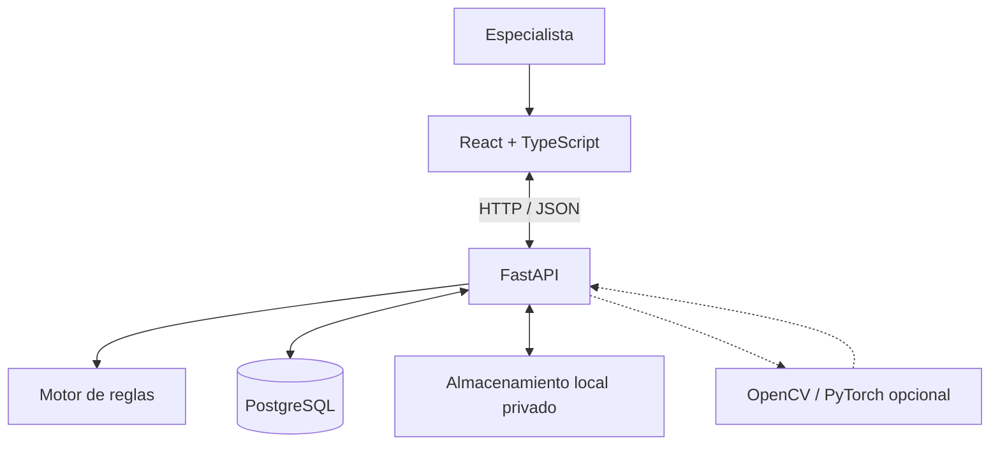
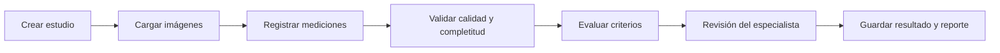
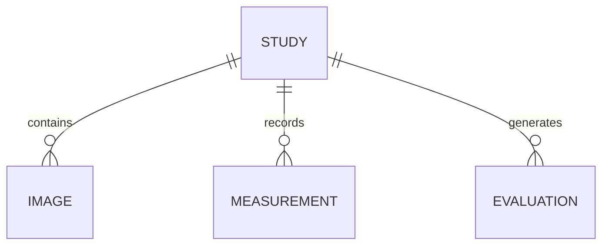
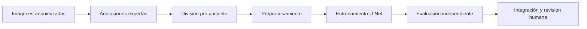

# MLOpérculo

**Plataforma de apoyo al análisis de ultrasonido dúplex Doppler para el síndrome de salida torácica venoso (vTOS).**


> **Estado del proyecto:** propuesta técnica y funcional del MVP. La arquitectura, los endpoints y las instrucciones de ejecución describen la implementación prevista; todavía no representan funcionalidades verificadas en un repositorio existente.
>
> **Uso previsto:** prototipo de investigación y apoyo a la revisión por especialistas. No es un dispositivo médico validado ni sustituye el diagnóstico de un radiólogo.

## Contenido

- [Descripción](#descripción)
- [Fundamento científico](#fundamento-científico)
- [Objetivos](#objetivos)
- [Alcance del MVP](#alcance-del-mvp)
- [Stack tecnológico](#stack-tecnológico)
- [Arquitectura](#arquitectura)
- [Flujo de trabajo](#flujo-de-trabajo)
- [Motor de evaluación](#motor-de-evaluación)
- [Modelo de datos](#modelo-de-datos)
- [API REST](#api-rest)
- [Inteligencia artificial](#inteligencia-artificial)
- [Estructura del repositorio](#estructura-del-repositorio)
- [Instalación y ejecución](#instalación-y-ejecución)
- [Pruebas y validación](#pruebas-y-validación)
- [Privacidad y seguridad](#privacidad-y-seguridad)
- [Roadmap](#roadmap)
- [Colaboración](#colaboración)
- [Referencias](#referencias)

## Descripción

MLOpérculo propone centralizar el registro, la comparación y el análisis de imágenes de ultrasonido dúplex Doppler de la vena subclavia durante maniobras dinámicas de abducción del brazo a **0°, 90° y 180°**.

La plataforma permitirá almacenar estudios anonimizados, registrar mediciones de diámetro y velocidad de flujo, comparar los cambios vasculares entre posiciones y generar resultados estructurados para revisión especializada.

La primera versión utilizará mediciones proporcionadas por el especialista y un motor de reglas determinista. A partir de una colección de imágenes anotadas y calibradas, se podrá incorporar visión por computadora y aprendizaje profundo para asistir en la segmentación y medición vascular.

## Fundamento científico

El proyecto se basa en el artículo *Diagnostic criteria of ultrasound duplex doppler for venous thoracic outlet syndrome: fifteen years’ experience*, publicado por Figueroa-Sánchez y Montaño-Rodríguez en 2022.

El estudio retrospectivo incluyó **97 pacientes y 110 exploraciones** de ultrasonido dúplex Doppler realizadas entre 2005 y 2020. Los autores propusieron dos criterios ultrasonográficos para vTOS durante la maniobra a 180°:

1. Reducción completa del diámetro de la vena subclavia a 0 mm.
2. Ausencia de velocidad de flujo Doppler (0 cm/s).

La tabla 1 del artículo reporta los siguientes valores medios:

| Parámetro | Doppler normal (n = 19) | vTOS puro (n = 84) | TOS mixto (n = 6) |
| --- | ---: | ---: | ---: |
| Diámetro a 0° (mm) | 7.37 | 7.42 | 7.33 |
| Diámetro a 180° (mm) | 3.68 | 0 | 0 |
| Velocidad a 0° (cm/s) | 35.74 | 29.98 | 22.83 |
| Velocidad a 90° (cm/s) | 35.79 | 27.87 | 18.83 |
| Velocidad a 180° (cm/s) | 35.53 | 0 | 0 |

La figura 1 documenta las tres posiciones de adquisición y las figuras 3 y 5 ilustran ejemplos de comportamiento vascular normal y anormal. El diámetro a 90° no se reportó en la tabla de resultados; el MVP podrá registrarlo cuando se disponga de esa medición.

**Limitaciones:** el trabajo fue retrospectivo, las exploraciones fueron realizadas por un solo radiólogo experto y no se utilizó venografía por catéter como estándar de referencia. Los criterios requieren validación prospectiva independiente. Las cifras de la publicación no son métricas de desempeño de MLOpérculo ni constituyen un conjunto de entrenamiento disponible.

DOI: [10.24875/JMEXFRI.M21000005](https://doi.org/10.24875/JMEXFRI.M21000005).

## Objetivos

### Objetivo general

Desarrollar un prototipo web que facilite el análisis comparativo de estudios Doppler de la vena subclavia durante maniobras dinámicas y estructure los hallazgos asociados con los criterios de investigación para vTOS.

### Objetivos específicos

- Estandarizar el registro de estudios y sus mediciones por posición y lateralidad.
- Facilitar la comparación de imágenes en las tres posiciones.
- Calcular la variación relativa del diámetro vascular entre 0° y 180°.
- Evaluar los criterios publicados mediante reglas transparentes y reproducibles.
- Conservar evidencia de las mediciones y permitir su revisión por el especialista.
- Preparar una base de datos de investigación para una futura etapa de segmentación asistida mediante IA.

## Alcance del MVP

| Módulo | Funcionalidad | Prioridad |
| --- | --- | --- |
| Estudios | Crear, consultar y eliminar estudios anonimizados por lado evaluado | Obligatoria |
| Imágenes | Cargar y visualizar archivos PNG/JPEG por posición y modalidad | Obligatoria |
| Mediciones | Registrar diámetro (mm), velocidad (cm/s), permeabilidad y calidad técnica | Obligatoria |
| Comparación | Mostrar las posiciones 0°, 90° y 180° en una vista comparativa | Obligatoria |
| Evaluación | Calcular compresión y verificar los criterios de investigación | Obligatoria |
| Revisión | Confirmar o corregir mediciones y registrar observaciones | Obligatoria |
| Reporte | Mostrar resultados estructurados y una vista imprimible | Obligatoria |
| Historial | Consultar estudios y resultados previamente almacenados | Obligatoria |
| Visión por computadora | Segmentación asistida de la vena subclavia | Opcional, según datos |

En la primera versión se trabajará con imágenes estáticas anonimizadas y valores registrados manualmente. Se dejarán fuera la integración PACS/RIS, el soporte DICOM completo, el análisis de video en tiempo real, la infraestructura cloud, el diagnóstico automático y la evaluación integral de las variantes arterial y neurogénica del TOS.

## Stack tecnológico

| Componente | Tecnología | Responsabilidad |
| --- | --- | --- |
| Frontend | React + TypeScript + Vite | Interfaz web y comparación de imágenes |
| Estilos | Tailwind CSS | Diseño de la interfaz |
| Backend | Python + FastAPI | API, validaciones y motor de evaluación |
| Validación de datos | Pydantic | Esquemas de entrada y salida |
| Base de datos | PostgreSQL | Estudios, mediciones, imágenes y resultados |
| Persistencia | SQLAlchemy | Acceso a PostgreSQL desde Python |
| Archivos | Volumen local de Docker | Almacenamiento privado de imágenes |
| Procesamiento de imágenes | OpenCV | Utilidades de imagen, si se requieren |
| IA (opcional) | PyTorch + U-Net | Segmentación vascular experimental |
| Anotación (opcional) | Label Studio | Creación de máscaras por especialistas |
| Pruebas | pytest | Validación de la lógica y API |
| Entorno | Docker Compose | Ejecución reproducible de la aplicación |
| Versionamiento | Git + GitHub | Colaboración y gestión de cambios |

No se necesita una GPU para la versión basada en mediciones manuales. OpenCV y PyTorch pueden incorporarse cuando exista un caso de uso y datos suficientes; no son dependencias obligatorias del primer incremento.

## Arquitectura

Se propone una arquitectura cliente-servidor sencilla, con un backend monolítico, una base de datos relacional y almacenamiento local persistente. No se requieren microservicios para el MVP.



El frontend se comunica exclusivamente con la API. El backend valida entradas, gestiona archivos y mediciones, calcula resultados y mantiene su persistencia. La lógica de evaluación debe mantenerse separada de los endpoints para facilitar pruebas unitarias y cambios futuros en los criterios.

## Flujo de trabajo



1. El usuario crea un estudio con un código anónimo e indica el lado evaluado.
2. Carga imágenes correspondientes a modo B, Doppler color o Doppler espectral, identificando el ángulo de la maniobra.
3. Registra las mediciones disponibles y la calidad de adquisición. Los valores no medidos permanecen nulos.
4. El sistema valida que las imágenes y mediciones pertenezcan al mismo lado del estudio y comprueba unidades, completitud y calidad.
5. Se calcula el porcentaje de compresión y se verifica si se cumplen los dos criterios propuestos por el artículo.
6. El especialista revisa las imágenes, corrige mediciones si procede y agrega observaciones.
7. La plataforma guarda la evaluación con su versión de reglas y estado de revisión.

Para un estudio bilateral se registran dos unidades de evaluación, una por lado, vinculadas al mismo código anónimo cuando corresponda. No se deben combinar mediciones de lados distintos.

## Motor de evaluación

### Cálculo del porcentaje de compresión

```text
Compresión (%) = ((D0 - D180) / D0) * 100
```

Donde `D0` es el diámetro basal y `D180` es el diámetro durante la maniobra a 180°, ambos en milímetros. El cálculo solo es válido si ambos valores están disponibles, han sido obtenidos con calidad suficiente y `D0 > 0`.

Ejemplo sintético: un diámetro basal de 7.4 mm y un diámetro de 0 mm a 180° representan una reducción del 100 %.

### Reglas propuestas para el software

| Condición | Estado mostrado |
| --- | --- |
| Diámetro a 180° = 0 mm y velocidad a 180° = 0 cm/s, ambos confirmados y con estudio evaluable | Cumple los criterios propuestos de investigación |
| Mediciones suficientes, técnicamente adecuadas y al menos uno de los criterios no se cumple | No cumple ambos criterios propuestos |
| Información faltante, calidad insuficiente, hallazgos contradictorios o basal no evaluable | No evaluable / requiere revisión |

La ausencia de señal por mala ventana acústica o limitaciones técnicas **no equivale** a ausencia real de flujo. Tampoco se debe convertir un dato faltante en cero. El estado «no cumple ambos criterios» no significa ausencia de enfermedad ni sustituye la valoración clínica.

No se introducen umbrales alternativos ni redondeos automáticos para declarar una oclusión. Cualquier tolerancia instrumental deberá definirse y validarse con el especialista antes de incorporarla.

El reporte incluirá mediciones por posición, compresión calculada, estado de cada criterio, calidad técnica, observaciones y estado de revisión. La evaluación deberá recalcularse e invalidar una revisión anterior cuando se modifiquen mediciones relevantes.

## Modelo de datos



| Entidad | Campos principales |
| --- | --- |
| `studies` | `id`, `subject_code`, `laterality`, `created_at` |
| `images` | `id`, `study_id`, `angle`, `modality`, `storage_key`, `created_at` |
| `measurements` | `id`, `study_id`, `angle`, `diameter_mm`, `velocity_cm_s`, `patency`, `quality`, `notes`, `updated_at` |
| `evaluations` | `id`, `study_id`, `compression_pct`, `criteria_met`, `status`, `rule_version`, `review_status`, `review_notes`, `created_at` |

Restricciones previstas:

- Ángulos permitidos: `0`, `90`, `180`; lateralidad obligatoria: `left` o `right`.
- Diámetro y magnitud de velocidad no negativos cuando estén disponibles; valores desconocidos representados por `null`.
- Una medición vigente por estudio y ángulo; varias imágenes pueden respaldar una posición.
- Una evaluación conserva una instantánea de las mediciones que la originaron (por ejemplo, un campo JSON adicional).
- Los identificadores son internos; los nombres y demás datos identificativos del paciente no forman parte del esquema.

## API REST

Contrato inicial propuesto. Se implementará y documentará mediante OpenAPI/Swagger de FastAPI.

| Método | Endpoint | Descripción |
| --- | --- | --- |
| `GET` | `/health` | Verificar disponibilidad del backend |
| `POST` | `/api/studies` | Crear un estudio |
| `GET` | `/api/studies` | Listar estudios |
| `GET` | `/api/studies/{id}` | Consultar estudio y mediciones |
| `DELETE` | `/api/studies/{id}` | Eliminar estudio y archivos asociados según política de investigación |
| `POST` | `/api/studies/{id}/images` | Cargar imagen y metadatos (`multipart/form-data`) |
| `GET` | `/api/images/{id}` | Recuperar imagen mediante la API |
| `PUT` | `/api/studies/{id}/measurements/{angle}` | Crear o actualizar medición |
| `POST` | `/api/studies/{id}/evaluations` | Generar evaluación con la versión vigente de reglas |
| `GET` | `/api/studies/{id}/evaluations` | Consultar historial de evaluaciones |
| `PATCH` | `/api/evaluations/{id}/review` | Registrar revisión y observaciones |

Ejemplo de respuesta esperada para una evaluación (datos sintéticos, no un caso clínico real):

```json
{
  "study_id": "demo-001",
  "laterality": "right",
  "diameter_0_mm": 7.4,
  "diameter_180_mm": 0.0,
  "velocity_180_cm_s": 0.0,
  "compression_pct": 100.0,
  "criteria_met": true,
  "status": "criteria_met",
  "rule_version": "1.0",
  "review_status": "pending"
}
```

## Inteligencia artificial

La IA es una extensión del MVP, no un requisito para completar su primera versión. El objetivo inicial será segmentar la luz de la vena subclavia en imágenes de modo B donde sus límites sean identificables, utilizando una arquitectura U-Net implementada con PyTorch.

### Pipeline experimental



| Elemento | Propuesta |
| --- | --- |
| Entrada | Imágenes de ultrasonido modo B con metadatos de adquisición |
| Etiquetas | Máscaras de la luz vascular y estados de visibilidad definidos por expertos |
| Preprocesamiento | OpenCV, conservando la escala espacial y evitando deformaciones |
| Modelo | U-Net con PyTorch |
| Métricas | Dice e IoU para segmentación; MAE en mm para mediciones calibradas |
| Evaluación | Separar entrenamiento, validación y prueba por paciente, no por imagen |
| Salida | Máscara y, cuando sea posible, estimación de diámetro con revisión humana |

Las imágenes deben conservar una calibración espacial verificable para transformar mediciones de píxeles a milímetros. Una máscara vacía por falla de segmentación no demuestra colapso vascular. Si el vaso no puede identificarse de manera confiable, el sistema se abstendrá de emitir una medición automática.

El flujo Doppler y su ausencia se registrarán manualmente en esta fase. Su automatización requerirá una investigación específica con datos espectrales y controles de calidad; la segmentación U-Net por sí sola no resuelve ese problema.

No se afirma que exista un modelo entrenado ni un dataset de 110 estudios disponible para uso en el proyecto. La disponibilidad, permisos y calidad de los datos deberán confirmarse antes de comenzar esta etapa.

## Estructura del repositorio

Estructura propuesta para organizar el código:

```text
mloperculo/
├── frontend/
│   ├── src/
│   │   ├── components/
│   │   ├── pages/
│   │   ├── services/
│   │   ├── types/
│   │   └── App.tsx
│   ├── package.json
│   └── Dockerfile
├── backend/
│   ├── app/
│   │   ├── api/
│   │   ├── models/
│   │   ├── schemas/
│   │   ├── services/
│   │   │   ├── evaluation.py
│   │   │   └── storage.py
│   │   ├── database.py
│   │   └── main.py
│   ├── tests/
│   ├── requirements.txt
│   └── Dockerfile
├── ml/                      # Etapa opcional
│   ├── notebooks/
│   ├── src/
│   └── README.md
├── docs/
├── .env.example
├── .gitignore
├── compose.yaml
└── README.md
```

Los estudios reales, archivos de entrenamiento y credenciales se mantienen fuera de Git. Los datos sintéticos de prueba pueden almacenarse en `backend/tests/fixtures/` sin información personal.

## Instalación y ejecución

> Guía prevista para cuando estén implementados los servicios, Dockerfiles y el archivo `compose.yaml`. No se ha verificado la ejecución porque este README documenta el proyecto en su etapa de planeación.

### Requisitos

- Git.
- Docker con Docker Compose v2.
- Para desarrollo fuera de contenedores: Python 3.11+ y Node.js 22 LTS o una versión compatible con las dependencias elegidas.

### Configuración del entorno

Desde la raíz de la copia local del repositorio:

```bash
cp .env.example .env
```

En PowerShell se puede utilizar `Copy-Item .env.example .env`.

Ejemplo de variables previstas en `.env.example`:

```dotenv
POSTGRES_DB=mloperculo
POSTGRES_USER=mloperculo
POSTGRES_PASSWORD=change_me_local_only
DATABASE_URL=postgresql://mloperculo:change_me_local_only@db:5432/mloperculo
UPLOAD_DIR=/app/uploads
VITE_API_URL=http://localhost:8000
```

La contraseña es un ejemplo para desarrollo local. Si se cambia, actualizar también `DATABASE_URL`. No almacenar el archivo `.env` en Git. El servicio de base de datos utilizará el nombre `db` dentro de la red de Compose. El backend deberá inicializar o migrar el esquema antes de aceptar estudios, y la base de datos y archivos deberán usar volúmenes persistentes.

### Levantar la aplicación

```bash
docker compose up --build -d
docker compose ps
```

| Servicio | Dirección local prevista |
| --- | --- |
| Frontend | http://localhost:5173 |
| API | http://localhost:8000 |
| Swagger UI | http://localhost:8000/docs |
| Health check | http://localhost:8000/health |

Los puertos de frontend y backend deberán publicarse únicamente en `127.0.0.1` durante el desarrollo local. PostgreSQL no necesita un puerto expuesto al host.

### Logs y pruebas

```bash
docker compose logs -f backend
docker compose exec backend pytest -q
```

### Detener los servicios

```bash
docker compose down
```

Los volúmenes de datos se conservarán al detener los servicios. Evitar `docker compose down -v` salvo que se quiera eliminar deliberadamente la información persistente del entorno.

## Pruebas y validación

### Pruebas funcionales mínimas

| Caso | Entrada o condición | Resultado esperado |
| --- | --- | --- |
| T01 | Diámetro basal 7.4 mm, diámetro final 0 mm, flujo final 0 cm/s confirmados y adquisición adecuada | 100 % de compresión y cumplimiento de criterios |
| T02 | Diámetro basal 8 mm, diámetro final 4 mm y flujo final 35 cm/s | 50 % de compresión; no cumple ambos criterios |
| T03 | Diámetro final 3 mm y flujo final 0 cm/s con adquisición adecuada | No cumple ambos criterios; revisar hallazgos |
| T04 | Diámetro final 0 mm y flujo no medido | No evaluable; no asumir cero |
| T05 | Flujo aparentemente ausente por calidad insuficiente | No evaluable; revisión técnica |
| T06 | Diámetro basal 0 mm o desconocido | No calcular porcentaje; requiere revisión |
| T07 | Archivo inválido, ángulo no permitido o valor negativo | Rechazar entrada con mensaje claro |
| T08 | Modificación de una medición revisada | Conservar historial y requerir nueva evaluación/revisión |
| T09 | Estudios derecho e izquierdo del mismo sujeto | Mantener análisis independientes |

Los ejemplos anteriores son pruebas de software, no resultados de validación clínica.

### Criterios de aceptación del MVP

- La aplicación arranca con Docker Compose y persiste los datos tras reiniciarse.
- Se puede crear un estudio, cargar imágenes, registrar mediciones y comparar las tres posiciones.
- Las reglas generan resultados reproducibles, manejan datos faltantes y pasan las pruebas unitarias.
- El usuario puede revisar los hallazgos y recuperar el estudio con sus imágenes y resultados.
- La interfaz no presenta la evaluación automatizada como un diagnóstico definitivo.

### Validación científica posterior

Antes de utilizar el sistema en un entorno asistencial se requiere un protocolo de validación aprobado, anotaciones independientes por especialistas, evaluación de reproducibilidad entre operadores y contraste con referencias clínicas apropiadas. Si se desarrolla un clasificador, su sensibilidad, especificidad y otras métricas deberán estimarse en datos independientes; no pueden deducirse de las cifras del artículo original.

## Privacidad y seguridad

- Utilizar únicamente imágenes sintéticas o debidamente anonimizadas y autorizadas para investigación.
- Verificar tanto los metadatos como las etiquetas identificativas incrustadas en los píxeles de ultrasonido.
- No publicar estudios, nombres, expedientes, contraseñas ni archivos de configuración privada en GitHub.
- Validar tipo real, tamaño y contenido de las imágenes; generar nombres internos seguros y evitar rutas arbitrarias.
- Mantener el almacenamiento privado, sin exposición pública directa, y limitar el MVP inicial a ejecución local con acceso controlado.
- Definir con la institución responsable los permisos, consentimiento o base aplicable, retención, respaldo, eliminación y acceso a los datos antes de incorporar estudios reales.
- Incorporar autenticación, autorización, cifrado en tránsito, auditoría de acceso y revisión de seguridad antes de cualquier despliegue compartido o clínico.

## Roadmap

| Etapa | Entregable | Estado inicial |
| --- | --- | --- |
| 1. Base del proyecto | Repositorio, frontend, API, PostgreSQL y Docker Compose | Pendiente |
| 2. Gestión de estudios | Registro, almacenamiento y visualización de imágenes | Pendiente |
| 3. Mediciones y reglas | Formulario, comparación y cálculo de criterios | Pendiente |
| 4. Revisión y pruebas | Reporte, historial y pruebas automatizadas | Pendiente |
| 5. IA experimental | Dataset autorizado, anotaciones y evaluación de U-Net | Condicionada a datos |

La etapa 4 marca el cierre del MVP funcional. La etapa 5 se incorpora únicamente si se dispone de imágenes suficientes, etiquetadas, calibradas y autorizadas.

## Colaboración

Propuesta de organización para un equipo pequeño:

- **Frontend:** interfaz, experiencia de usuario y visualización de estudios.
- **Backend:** API, persistencia, reglas y pruebas.
- **Visión por computadora:** preparación de datos y experimentación cuando se habilite la etapa de IA.
- **Asesoría clínica:** definición del protocolo de registro, calidad técnica y revisión de los resultados.

El reparto de responsabilidades puede adaptarse al equipo. Se recomienda gestionar las tareas mediante GitHub Issues y trabajar con ramas cortas (`feat/`, `fix/`, `docs/`) y pull requests hacia `main`.

Ejemplo de convención de commits:

```text
feat: add study registration endpoint
fix: handle missing Doppler measurements
test: cover compression calculation
docs: update local setup
```

Cada cambio que afecte los criterios de evaluación deberá incluir pruebas y actualizar la documentación de la versión de reglas.

## Referencias

Figueroa-Sanchez, M., & Montaño-Rodriguez, L. J. (2022). Diagnostic criteria of ultrasound duplex doppler for venous thoracic outlet syndrome: fifteen years’ experience. *Journal of the Mexican Federation of Radiology and Imaging, 1*(1), 23–31. [https://doi.org/10.24875/JMEXFRI.M21000005](https://doi.org/10.24875/JMEXFRI.M21000005).

### Documentación técnica

- [React](https://react.dev/)
- [FastAPI](https://fastapi.tiangolo.com/)
- [PostgreSQL](https://www.postgresql.org/docs/)
- [Docker Compose](https://docs.docker.com/compose/)
- [OpenCV](https://docs.opencv.org/)
- [PyTorch](https://pytorch.org/docs/stable/index.html)

## Licencia y uso

La licencia del código está pendiente de acuerdo entre los responsables del proyecto. La publicación científica de referencia y los datos médicos tienen condiciones de uso independientes; su inclusión como referencia no otorga permiso para redistribuir imágenes, artículos o estudios clínicos.

---

**MLOpérculo · Investigación aplicada a imagenología vascular y desarrollo de software.**
